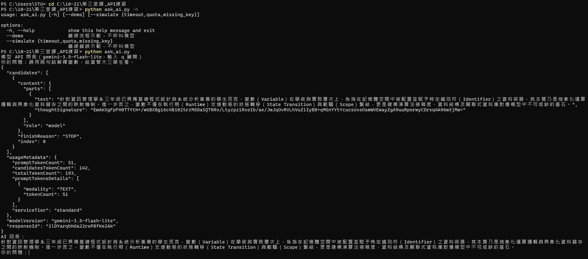
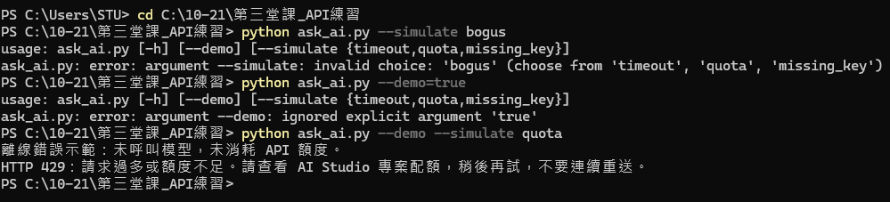
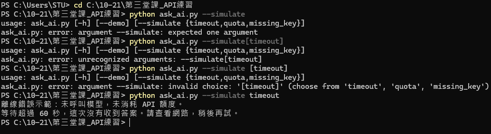
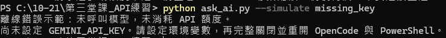
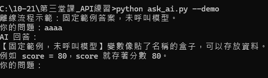
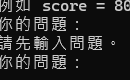
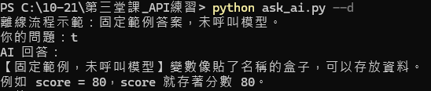

# 第三堂課｜讓 Python 程式接上 AI 模型

**測試與修改紀錄**

| 項目 | 內容 |
| --- | --- |
| 學號／組員 | D1124181010 龔祺竣 |
| 模型 ID | `gemini-3.5-flash-lite` |
| 環境 | Windows 11・PowerShell 5.1・Python 3.13.15 |
| 金鑰 | 已設定使用者環境變數 `GEMINI_API_KEY` |
| 執行日期 | 2026-10-21 |

> **本文件、所有程式檔與全部 7 張截圖，皆不含 API 金鑰。**
> 金鑰只存在於電腦的使用者環境變數，不寫入任何檔案。
> 截圖中的目錄為 `C:\10-21\第三堂課_API練習>`（`10-21` 為上課日期，非版本號）。

---

## 一、環境與設定

### 1.1 Python 安裝

| 項目 | 值 |
| --- | --- |
| 版本 | Python 3.13.15 |
| 安裝路徑 | `C:\Users\STU\AppData\Local\Programs\Python\Python313\` |
| 安裝方式 | `winget install --id Python.Python.3.13 --source winget --silent` |
| 確認 | `python --version` → `Python 3.13.15` |

本專案**只使用 Python 標準函式庫**（`argparse`、`json`、`os`、`socket`、`pathlib`、`urllib`），不需要 `pip install`。

### 1.2 環境變數 `GEMINI_API_KEY`

| 項目 | 內容 |
| --- | --- |
| 名稱 | `GEMINI_API_KEY` |
| 值 | 自己的金鑰（**不填在本文件、不貼給任何人**） |
| 層級 | Windows「使用者變數」（`HKEY_CURRENT_USER\Environment`） |
| 讀取位置 | `gemini_client.py` 第 43 行 `os.environ.get("GEMINI_API_KEY", "").strip()` |

驗證是否已設定（**只會印 True／False，不會印出金鑰**）：

```powershell
python -c "import os; print(bool(os.environ.get('GEMINI_API_KEY')))"
```

輸出 `True` 代表 Python 讀得到值，仍需完成真實 API 呼叫才算通過。

> **改完環境變數一定要「完整關閉」PowerShell 與 OpenCode 再重開。**
> 原因：環境變數是行程**啟動那一刻**由作業系統複製一份給它的，之後不會同步。
> 已經開著的視窗永遠讀不到你之後才設定的值。

---

## 二、執行指令

| 指令 | 用途 | 是否連線 |
| --- | --- | --- |
| `python ask_ai.py` | 真實 API 問答（輸入 `q` 離開） | **會** |
| `python ask_ai.py --demo` | 離線流程示範，固定範例答案 | 不會 |
| `python ask_ai.py --simulate timeout` | 離線逾時示範 | 不會 |
| `python ask_ai.py --simulate quota` | 離線額度示範 | 不會 |
| `python ask_ai.py --simulate missing_key` | 離線無金鑰示範 | 不會 |
| `python ask_ai.py -h` | 顯示使用說明 | 不會 |
| `q` | 結束問答迴圈 | — |

`--demo` 與 `--simulate` **都完全不連線、不消耗 API 額度**。

`-h` 顯示的說明：

```
usage: ask_ai.py [-h] [--demo] [--simulate {timeout,quota,missing_key}]

options:
  -h, --help            show this help message and exit
  --demo                離線流程示範，不呼叫模型
  --simulate {timeout,quota,missing_key}
                        離線錯誤示範，不呼叫模型
```

---

## 三、第一次真實 API 呼叫

**執行指令**：`python ask_ai.py`

**問題**：

```
請用兩句話解釋變數，給資管大三學生看。
```

**實際回答**：

```
變數是程式記憶體中用來儲存資料的容器，其型別決定了可存放的資料種類與大小。
對資管系學生而言，變數就像資料庫中的一個欄位，是所有邏輯運算與資料流動的基礎單位。
```

**我如何核對**：

1. **形式**：回應剛好兩句話，符合「用兩句話」的要求。
2. **內容**：兩句都在解釋「變數」本身，沒有跑題，也沒有把變數講成其他觀念。
3. **程度**：用「資料庫欄位」這個資管生熟悉的比喻，符合 `system_prompt` 要求的繁體中文與資管系背景。
4. **無編造**：沒有出現我沒有問過的學校名稱、課程名稱或任何需要查證的特定事實。

**本次是**：**真實 API**（已連線，有 `usageMetadata` 與 `responseId` 為證）



> 上圖為 `-h` 與真實 API 呼叫。回傳的完整 JSON 中可見 `"modelVersion": "gemini-3.5-flash-lite"`、`"totalTokenCount": 193`，代表這是**真的送出去並拿到回應**，不是離線範例。

### 補充：追問模型「你的答案從哪來」

為了驗證模型對自己來源的認知，我在同一次真實呼叫後追問：

```
對於前面的回答，還有紀錄嗎？請問這些回答是根據甚麼來源和資料核對的？
```

模型回應：

> 1. **前面的紀錄還在嗎？** 在同一個對話群組（Session）裡，系統會暫時保留我們前面聊天的上下文……一旦重新整理、關閉視窗，或超過系統的對話記憶長度限制，紀錄就可能會消失。
>
> 2. **這些回答是根據什麼來源和資料核對的？**
>    * **一般知識與學理：** 根據我被訓練時所吸收的網際網路公開資訊、資管系（MIS）的學術理論、業界常態……
>    * **學校特定公告的限制：** **資訊不足。** 如果你問的是學校的最新選課規定、畢業門檻或特定行政公告，**我無法憑空編造**。因為我沒有直接連線到你們學校的校務行政系統或內網。

**這個回答本身就是最好的證據**：模型自己承認「沒有可靠的外部來源」「資訊不足時無法編造」，正好呼應第七節「AI 回答為什麼仍需核對」。

---

## 四、各類參數與離線測試

### 4.1 參數打錯時 argparse 的攔截



| 指令 | 結果 | exit code |
| --- | --- | --- |
| `python ask_ai.py --simulate bogus` | `error: argument --simulate: invalid choice: 'bogus' (choose from 'timeout', 'quota', 'missing_key')` | 2 |
| `python ask_ai.py --demo=true` | `error: argument --demo: ignored explicit argument 'true'` | 2 |
| `python ask_ai.py --demo --simulate quota` | 進 `--simulate` 分支，印出 429 訊息 | 0 |

**觀察：**

- `choices=[...]` 會自動擋掉白名單以外的值，並把可選項列出來，程式**連 `main()` 都還沒進入就結束**。
- `--demo` 是 `action="store_true"`（布林開關），**不接受任何值**，所以 `--demo=true` 會被擋。
- 兩個參數同時給時，`--simulate` **優先**，因為 `ask_ai.py` 第 25 行的 `if args.simulate:` 先判斷，且用完 `return` 就離開了。

### 4.2 `--simulate timeout` 與常見打錯方式



| 指令 | 結果 |
| --- | --- |
| `--simulate`（漏填值） | `error: argument --simulate: expected one argument` |
| `--simulate[timeout]`（黏在一起） | `error: unrecognized arguments: --simulate[timeout]` |
| `--simulate [timeout]`（多加中括號） | `error: invalid choice: '[timeout]'` |
| `--simulate timeout`（正確） | 離線錯誤示範 → 「等待超過 60 秒，這次沒有收到答案。請查看網路，稍後再試。」 |

**實測輸出：**

```
離線錯誤示範：未呼叫模型，未消耗 API 額度。
等待超過 60 秒，這次沒有收到答案。請查看網路，稍後再試。
```

### 4.3 `--simulate missing_key`



```
離線錯誤示範：未呼叫模型，未消耗 API 額度。
尚未設定 GEMINI_API_KEY。請設定環境變數，再完整關閉並重開 OpenCode 與 PowerShell。
```

### 4.4 `--demo` 離線流程示範



```
離線流程示範：固定範例答案，未呼叫模型。
你的問題：aaaa
AI 回答：
【固定範例，未呼叫模型】變數像貼了名稱的盒子，可以存放資料。
例如 score = 80，score 就存著分數 80。
```

**重點**：即使問題是無意義的 `aaaa`，答案仍然是同一段固定文字 —— 這是**寫死的範例，不是模型的回答**，不可當作串接成功的證據。

### 4.5 空白輸入



```
你的問題：請先輸入問題。
你的問題：
```

對應 `ask_ai.py` 第 41–43 行：`question` 被 `.strip()` 清成空字串後走 `continue`，**不會送出任何請求**，也不會結束程式。

### 4.6 參數縮寫 `--d`



```
離線流程示範：固定範例答案，未呼叫模型。
你的問題：t
AI 回答：
【固定範例，未呼叫模型】變數像貼了名稱的盒子，可以存放資料。
例如 score = 80，score 就存著分數 80。
```

`--d` 是 `--demo` 的**前綴縮寫**，因目前只定義了 `--demo` 與 `--simulate` 兩個參數，`--d` 只對得上 `--demo` 所以會被接受。

> ⚠️ **不要依賴縮寫**。若日後加上 `--dump`，`--d` 會變模糊而報錯。正式使用一律打完整名稱。

---

## 五、`system_prompt` 修改前後比較

| | 內容 |
| --- | --- |
| **原本** | `請用繁體中文，為資管系大三學生簡短說明。資訊不足時請說明，不要編造學校公告。` |
| **修改後** | `請用學術文筆，碩士等級的中文，為了考驗教授底下的學生進行說明，不需要簡短說明。資訊不足時請說明。` |

**同一個問題**：`請用兩句話解釋變數，給資管大三學生看。`

**修改前**：

```
變數是程式記憶體中用來儲存資料的容器，其型別決定了可存放的資料種類與大小。
對資管系學生而言，變數就像資料庫中的一個欄位，是所有邏輯運算與資料流動的基礎單位。
```

**修改後**：

```
就資訊管理學門之學術範式而言，變數乃指研究者用以 operacionalize（操作化）抽象概念、
具備可變動數值或屬性之邏輯符號，其於系統分析與實證研究中，扮演著承載結構化資料與
檢驗因果假設之核心載體。

據此，在資訊系統之演算法則與資料庫綱要設計中，變數不僅為記憶體位址之抽象映射與
狀態暫存之容器，更是串接系統行為、量化營運效能及推論資訊科技價值之基本
epistemological（知識論）與 methodological（方法論）單元。
```

**差異分析**：

| 面向 | 修改前 | 修改後 |
| --- | --- | --- |
| 語氣 | 白話、可直接聽懂 | 書面語、論文式 |
| 用詞 | 「容器」「資料庫欄位」 | 「邏輯符號」「核心載體」 |
| 外文 | 幾乎沒有 | 大量夾雜（operacionalize、epistemological、methodological） |
| 長度 | 兩句、精簡 | 兩段、明顯變長（`不需要簡短說明` 生效） |
| 對大三學生 | ✅ 適合，可直接當教材 | ❌ 偏難，需自己轉譯 |

**結論**：`system_prompt` 確實**有效控制了模型的回答風格**。但「照指令做」不等於「回答更好用」—— 修改後雖然完全符合新指令，對原本目標讀者（資管大三）反而不合適，這正是第六節與第七節要談的核對問題。


---

## 六、是否仍能處理錯誤

**結論：是。** 改完 `system_prompt` 之後，所有錯誤處理路徑全部正常運作。

| 錯誤類型 | 指令 | 實際輸出 | 截圖 |
| --- | --- | --- | --- |
| 逾時 | `--simulate timeout` | 等待超過 60 秒，這次沒有收到答案。請查看網路，稍後再試。 | 圖 4.2 |
| 額度不足 | `--simulate quota` | HTTP 429：請求過多或額度不足。請查看 AI Studio 專案配額，稍後再試，不要連續重送。 | 圖 4.1 |
| 未設金鑰 | `--simulate missing_key` | 尚未設定 GEMINI_API_KEY。請設定環境變數，再完整關閉並重開 OpenCode 與 PowerShell。 | 圖 4.3 |
| 空白輸入 | 直接按 Enter | 請先輸入問題。 | 圖 4.5 |
| 參數非法 | `--simulate bogus` | `error: argument --simulate: invalid choice: 'bogus'` | 圖 4.1 |
| 參數漏值 | `--simulate` | `error: argument --simulate: expected one argument` | 圖 4.2 |

### 為什麼改 `system_prompt` 不會讓錯誤處理壞掉

`system_prompt` 只會被塞進 request body 的 `systemInstruction`（`gemini_client.py` 第 53 行），而三條錯誤路徑都跟它無關：

| 錯誤 | 發生位置 | 跟 body 內容有關嗎 |
| --- | --- | --- |
| 未設金鑰 | `gemini_client.py:43–45` | 否，在 request 組裝**之前**就擋掉了 |
| 逾時 | `gemini_client.py:66–70` | 否，是連線層的問題 |
| HTTP 4xx/5xx | `gemini_client.py:63–65` | 否，是伺服器回的狀態 |

所以改提示詞只會影響「成功的時候答案長怎樣」，不會影響錯誤判斷。

### 補充：真實 API 路徑的錯誤驗證

離線 `--simulate` 是印預設字串、不連線。準備本文件時，以相同環境補測了兩條**真實路徑**，證明錯誤處理在真實情境下同樣有效：

| 驗證方式 | 實際輸出 | 走到的程式碼 |
| --- | --- | --- |
| 清掉 `GEMINI_API_KEY` 後執行 `python ask_ai.py` | 這次未取得答案：尚未設定 GEMINI_API_KEY。請設定環境變數，再完整關閉並重開 OpenCode 與 PowerShell。 | `gemini_client.py:45` |
| 把 `config.json` 的 `model` 暫時改成不存在的名稱並真的送請求 | 這次未取得答案：HTTP 404：找不到模型或 API 路徑。請核對 config.json 的模型名稱與專案可用模型。 | `gemini_client.py:63–65` |

兩者的 **exit code 都是 0** —— 代表程式是**「處理掉」錯誤**而非崩潰。若哪天看到非 0，就代表有例外沒有被接到。

> 補測是在**複製到暫存資料夾**的副本上進行，原始 `config.json` 未被修改（`model` 仍為 `gemini-3.5-flash-lite`）。

---

## 七、我用自己的話說明

### Coding Agent 的工作

Coding Agent（OpenCode）做的事，主要是幫我讀懂這個專案原本在做什麼，而不是直接幫我把答案生出來。它讀完 `ask_ai.py`、`gemini_client.py`、`config.json` 之後，幫我把三個檔案的分工講清楚：哪裡負責收問題、哪裡負責真的打 API、哪裡負責把答案印出來，也告訴我 `GEMINI_API_KEY` 是用 `os.environ` 從環境變數讀出來的，不要寫進程式裡面。改 `system_prompt` 的時候，它幫我確認 JSON 沒有被改壞，也提醒我要重跑同一個問題才比較得出前後差異。它沒有碰我的金鑰，API 是我自己開終端機跑 `ask_ai.py` 才發出去的。

> 總結：**它負責「讓你懂」，我負責「真的跑」。** 檔案之間的接點是 `ask_ai.py` 第 5 行的 `from gemini_client import ...`，而金鑰只在 `gemini_client.py` 第 43 行被讀一次，兩處都是老師可以隨時查證的。

### 我的程式如何呼叫 LLM

`ask_ai.py` 和 `gemini_client.py` 是分工的。`ask_ai.py` 負責收問題跟顯示，它用 `input()` 拿到我打的字，丟給 `gemini_client.py` 的 `ask_model()`，最後把拿到的文字用 `print()` 印出來，中間把錯誤都換成中文訊息，所以沒設金鑰或逾時的時候不會直接噴 traceback 出來。

真正送出 request 的是 `ask_model()`：它用標準庫的 `urllib.request`，POST 到 `https://generativelanguage.googleapis.com/v1beta/models/{model}:generateContent`，模型名稱先經過 `quote()` 編碼，金鑰放在 `x-goog-api-key` 這個 header，逾時秒數則是從 `config.json` 的 `timeout_seconds` 讀的。body 送兩個東西，`systemInstruction` 放 `config.json` 的 `system_prompt`，`contents` 則是 `role=user` 加上我的問題。回來是 JSON，`extract_text()` 從 `candidates[0].content.parts` 抓 `text`，並把 `thought=true` 的思考片段濾掉，避免模型腦內推理混進正式答案。整個專案只用標準函式庫，不用 `pip install`。

> 流程五步：**收問題 → 交棒 `ask_model()` → 組 request 送出 → `urlopen()` 收 JSON → `extract_text()` 撈文字**。

### AI 回答為什麼仍需核對

程式只保證「有拿到文字」，不保證「內容是對的」。我這次問「請用兩句話解釋變數」，模型給的答案其實偏研究方法而不是資管生的直覺說法，尤其改成「學術文筆、碩士等級」那段 prompt 之後更明顯——技術上不算錯，但對大三學生來說很難直接當教材，這種就得自己判斷合不合用途。模型也可能把比喻講得不太對，或是摻進我根本沒問過的東西，嚴重一點還會自己編造不存在的事實，所以 `system_prompt` 才要特別寫「資訊不足時請說明，不要編造學校公告」。另外要分清楚 `--demo`：它印的是寫死的固定範例，不管問什麼答案都一樣，那個不能當成模型真的回答。再來像 429 這種錯誤，就算程式把錯誤處理得很漂亮，答案還是拿不到。總結來說程式只管「連得上、拿得到」，對不對還是要自己看過才敢交。

> **三層理由**：
> 1. **技術層** —— `extract_text()` 唯一的檢查是「答案是不是空字串」（`gemini_client.py:23`），沒有任何語意判斷。
> 2. **內容層** —— 模型會編造。第三節那段追問就是證據：它自承「資訊不足，無法憑空編造」，代表它本來就可能編。
> 3. **模式層** —— `--demo` 的答案是 `ask_ai.py:46–48` 寫死的字串，不是模型的回答。

---

## 八、交付前確認

| 檢查項目 | 結果 |
| --- | --- |
| 6 個專案檔案全文掃描金鑰樣式（`AIza...`） | **全部 clean** |
| 程式中出現的 `GEMINI_API_KEY` | 只是**變數名稱**（`os.environ.get(...)`），不是值 |
| 程式中出現的 `x-goog-api-key` | 只是 **header 名稱**，值來自環境變數 |
| 金鑰存放位置 | 只在**使用者環境變數**，不在任何檔案 |
| `config.json` | 只含 `model` / `timeout_seconds` / `system_prompt` |
| 完整 API 回應是否含金鑰 | 實測比對：**False**（回應中無 `AIza`、無 `x-goog-api-key`） |
| 7 張截圖是否含金鑰 | **否**，逐一檢視確認 |
| 錯誤訊息是否會洩漏 | 否，`except HTTPError` 刻意不印 HTTP 原文與 request |

**交付前確認程式與截圖沒有金鑰：是 ✅**

仍需人工再檢查的地方：

1. **環境變數設定畫面**會顯示完整金鑰 —— 截圖時只保留變數名稱 `GEMINI_API_KEY`，把「值」遮起來。
2. 終端機捲動畫面不要截到含金鑰的那一行。
3. 程式檔、`config.json`、本 README 內容，上傳前再掃一次。

---

## 附錄：上傳 Git 前的注意事項

1. **金鑰絕對不能進 git。** 金鑰只在環境變數，不在任何檔案，因此只要不要額外新增金鑰檔案就是安全的。
2. 建議的 `.gitignore`：

   ```gitignore
   __pycache__/
   *.pyc
   .env
   *.key
   ```

3. 上傳前最後確認（只看有無，不印出值）：

   ```powershell
   python -c "import os; print(bool(os.environ.get('GEMINI_API_KEY')))"
   ```

4. 本 README 使用**相對路徑**引用 `readme製作所需圖片/` 內的圖片，資料夾結構保持不變即可正常顯示。
